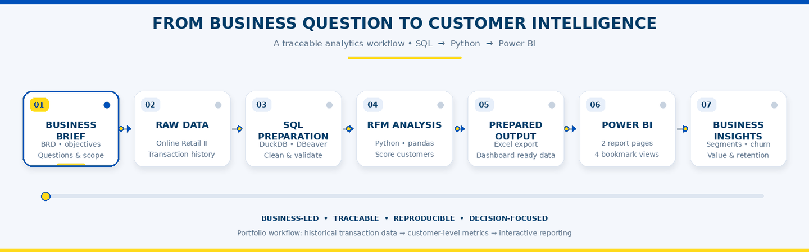

<div align="center">

# Customer Analytics & RFM Segmentation


<p>
  <strong>From business requirements to actionable customer intelligence.</strong>
</p>

<a href="https://duckdb.org/">
  
</a>
<a href="https://www.python.org/">
  
</a>
<a href="https://pandas.pydata.org/">
  
</a>
<a href="https://jupyter.org/">
  
</a>
<a href="https://powerbi.microsoft.com/">
  
</a>

<br/><br/>

<a href="powerbi/IKEA.pbix">
  
</a>
<a href="docs/IKEA_Gifting_BRD.docx">
  
</a>

<br/><br/>

**Created by Nikhil Kumar** · Data Analytics Portfolio Project

</div>

---

## ✦ Project Overview

How can a retailer distinguish its most valuable customers from those who have stopped purchasing?

This project explores that question using the **Online Retail II** transaction dataset. The objective is to transform historical retail transactions into a structured view of customer value, purchasing behaviour, and inactivity-based churn.

The workflow connects business requirements, SQL data preparation, customer-level RFM analysis, and interactive Power BI reporting.

Rather than treating SQL, Python, and Power BI as isolated tools, the project demonstrates how each contributes to a connected analytical process.

### Project Snapshot

<table>
<tr>
<td align="center" width="25%">

<h2>1.067M</h2>

<strong>RAW RECORDS</strong>

<sub>Source dataset</sub>

</td>
<td align="center" width="25%">

<h2>5,881</h2>

<strong>SEGMENTED CUSTOMERS</strong>

<sub>RFM summary</sub>

</td>
<td align="center" width="25%">

<h2>50.9%</h2>

<strong>CHURN FLAG RATE</strong>

<sub>90-day rule</sub>

</td>
<td align="center" width="25%">

<h2>6</h2>

<strong>CUSTOMER SEGMENTS</strong>

<sub>Rule-based RFM</sub>

</td>
</tr>
</table>

<div align="center">

<sub>Results shown are from this project's current analytical output. They do not represent the real IKEA corporation.</sub>

</div>

---

## 🎯 The Business Challenge

The fictional business, IKEA Gifting, needs a clearer understanding of customer value and retention risk.

When all customers receive the same attention, marketing and retention efforts may not be directed toward the customers who contribute the most value or those whose purchasing activity has declined.

The analysis explores how customer-level metrics can support more targeted decisions.

### Business Objectives

* **Understand customer value:** Identify segments with different purchasing behaviour and revenue contributions.
* **Identify inactivity:** Quantify customers who meet a defined 90-day inactivity threshold.
* **Compare performance over time:** Examine customer, revenue, and churn patterns across months, quarters, and years.
* **Explore geographic differences:** Compare customer value and performance across countries.
* **Support retention planning:** Provide structured customer segments that can inform further investigation and potential retention actions.

📄 **Start with the business requirements:** [Read the BRD](docs/IKEA_Gifting_BRD.docx)

---

## ⚡ The Analytics Workflow

<div align="center">



<p><em>Seven stages. One connected analytical process.</em></p>

</div>

The workflow connects the initial business problem to the final reporting layer:

| Stage | Implementation                 | Purpose                                                         |
| ----- | ------------------------------ | --------------------------------------------------------------- |
| 01    | Business Requirements Document | Define objectives, scope, and business questions                |
| 02    | Online Retail II               | Source historical transaction data                              |
| 03    | DuckDB SQL                     | Consolidate, standardize, inspect, and deduplicate transactions |
| 04    | Python & pandas                | Calculate RFM metrics and assign customer segments              |
| 05    | Excel export                   | Prepare the analytical dataset for reporting                    |
| 06    | Power BI                       | Build interactive customer and revenue analysis                 |
| 07    | Business interpretation        | Explore customer value, inactivity, and segment differences     |

**The result:** a traceable workflow connecting transaction preparation to customer analytics and interactive reporting.

---

## 📊 Dashboard Showcase

The finished Power BI report contains **two report pages and four bookmark-based analytical views**.

The screenshots below represent the four views of the existing dashboard, not four separate pages.

<table>
<tr>
<td colspan="2" align="center">

### 01 · OVERVIEW — CUSTOMER VIEW

<a href="powerbi/screenshots/overview_customer.png">

</a>

Customer distribution, retention by segment, and customer trends across time.

</td>
</tr>
<tr>
<td colspan="2" align="center">

### 02 · OVERVIEW — REVENUE VIEW

<a href="powerbi/screenshots/overview_revenue.png">

</a>

Revenue contribution, revenue retention, and trends across months, quarters, and years.

</td>
</tr>
<tr>
<td align="center" width="50%">

### 03 · RFM ANALYSIS — SEGMENT

<a href="powerbi/screenshots/rfm_segment.png">

</a>

Segment performance, RFM scores, and average customer value.

</td>
<td align="center" width="50%">

### 04 · RFM ANALYSIS — COUNTRY

<a href="powerbi/screenshots/rfm_country.png">

</a>

Country-level performance and top countries by average customer value.

</td>
</tr>
</table>

<div align="center">

### Explore the report yourself

<a href="powerbi/IKEA.pbix">
  
</a>

</div>

<sub>To explore interactive slicers, bookmark controls, and visual interactions, download the `.pbix` file and open it in Power BI Desktop.</sub>

---

## 💡 Key Findings

The current analytical output highlights several patterns relevant to customer management.

### 01 — Customer value is concentrated

The Champions segment contains **1,291 customers**, approximately 22% of the 5,881 customers in the RFM summary.

The Power BI revenue view attributes **68.1% of displayed revenue** to this segment.

**Business implication:** Champions may deserve particular attention when evaluating loyalty, repeat purchasing, and customer retention priorities.

### 02 — Inactivity is a significant signal

The dashboard reports a **50.9% churn flag rate**, based on the project's fixed 90-day inactivity rule.

**Business implication:** The flagged population provides a starting point for investigating customer disengagement and designing potential re-engagement strategies.

This is a rule-based classification of historical activity, not a prediction of future churn.

### 03 — Customer segments behave differently

Six segments provide a structured way to compare customer counts, revenue contribution, average RFM scores, and average customer value.

**Business implication:** A segmented view can support more differentiated customer strategies than a single aggregate customer metric.

### 04 — Time and geography add context

The report includes monthly, quarterly, and yearly trends, together with country-level customer and value comparisons.

**Business implication:** These views can help analysts identify patterns worth investigating further, although the charts alone do not establish their causes.

<sub>Findings describe the current analytical outputs and report. They should not be interpreted as verified performance figures for the real IKEA corporation.</sub>

---

## 🧰 Technology & Technical Implementation

<table>
<tr>
<th align="left">Technology</th>
<th align="left">Implementation in this project</th>
</tr>
<tr>
<td><strong>DuckDB SQL</strong></td>
<td>Combining source tables, type conversion, data-quality inspection, and deduplication using window functions.</td>
</tr>
<tr>
<td><strong>DBeaver</strong></td>
<td>SQL development and interaction with the DuckDB database.</td>
</tr>
<tr>
<td><strong>Python</strong></td>
<td>Customer-level analytical processing and segmentation.</td>
</tr>
<tr>
<td><strong>pandas</strong></td>
<td>Data preparation, aggregation, RFM scoring, segment assignment, and export.</td>
</tr>
<tr>
<td><strong>Jupyter Notebook</strong></td>
<td>Organizing and executing the analytical workflow.</td>
</tr>
<tr>
<td><strong>Power BI Desktop</strong></td>
<td>Interactive reporting, KPI presentation, filtering, and bookmark-based views.</td>
</tr>
<tr>
<td><strong>DAX</strong></td>
<td>Dashboard measures and key performance indicators.</td>
</tr>
</table>

### Technical Concepts Demonstrated

* SQL data consolidation using `UNION ALL`.
* Safe type conversion using `TRY_CAST` and date parsing using `TRY_STRPTIME`.
* Data-quality inspection and missing-value assessment.
* Exact duplicate identification using grouping and `ROW_NUMBER()`.
* Customer-level aggregation using pandas.
* Quantile-based RFM scoring.
* Rule-based customer segmentation.
* Inactivity-based churn flagging.
* Dataset export and Power BI reporting.
* Bookmark-based switching between analytical views.

---

## 🧠 RFM Segmentation Framework

RFM analysis evaluates customers using three dimensions of historical purchasing activity.

<table>
<tr>
<th>Metric</th>
<th>Meaning</th>
<th>Scoring direction</th>
</tr>
<tr>
<td><strong>Recency (R)</strong></td>
<td>Days since the most recent purchase</td>
<td>More recent purchases receive higher scores.</td>
</tr>
<tr>
<td><strong>Frequency (F)</strong></td>
<td>Number of distinct invoices</td>
<td>More invoices generally receive higher scores.</td>
</tr>
<tr>
<td><strong>Monetary (M)</strong></td>
<td>Total eligible transaction value</td>
<td>Higher monetary value generally receives higher scores.</td>
</tr>
</table>

Each metric is scored from **1 to 5** using quantile-based binning. Recency uses reverse scoring; Frequency and Monetary use ascending scoring.

### The six customer segments

<details>
<summary><strong>🏆 Champions</strong></summary>

Rule: `R_Score >= 4`, `F_Score >= 4`, and `M_Score >= 4`.

Customers who score highly on recency, frequency, and monetary value.

</details>

<details>
<summary><strong>💙 Loyal</strong></summary>

Rule applied after Champions: `R_Score >= 3` and `F_Score >= 3`.

Customers with relatively recent and frequent purchasing behaviour.

</details>

<details>
<summary><strong>⚠️ At Risk</strong></summary>

Rule applied after preceding segments: `R_Score <= 2` and `F_Score >= 3`.

Customers with low Recency scores despite comparatively high Frequency scores.

</details>

<details>
<summary><strong>🌱 New</strong></summary>

Rule applied after preceding segments: `R_Score >= 4` and `F_Score <= 2`.

Customers with recent purchasing activity but relatively low Frequency scores.

</details>

<details>
<summary><strong>🔎 Needs Attention</strong></summary>

Rule applied after preceding segments: `R_Score == 3` and `F_Score <= 2`.

Customers with moderate Recency scores and lower Frequency scores.

</details>

<details>
<summary><strong>🕰️ Lost</strong></summary>

Customers who do not match any of the preceding segment rules.

This is the remaining category in the implemented rule-based classification.

</details>

**Important:** The order of the rules matters because the notebook assigns the first matching segment. These are descriptive categories, not machine-learned customer classes.

### Churn Definition

The notebook applies a fixed 90-day inactivity threshold:

```python
rfm["IsChurned"] = rfm["Recency"] > 90
```

A customer is flagged as churned when more than 90 days have passed since their most recent purchase, measured against the fixed snapshot date of **December 10, 2011**.

---

## 🔬 Data Preparation & Analytical Methodology

### SQL — Transaction Preparation

The SQL workflow combines the two annual source tables, standardizes data types, checks data quality, and creates a deduplicated transaction table.

The key tables are:

| Table            | Purpose                                                        |
| ---------------- | -------------------------------------------------------------- |
| `RetailCombined` | Combined annual transaction data after initial type conversion |
| `RetailCleaned`  | Deduplicated transaction table used for subsequent analysis    |

The script also contains validation queries that help inspect missing data, non-positive quantities, date conversion, and duplicate transaction groups.

**Data-quality checks do not automatically mean all problematic rows are removed.** The SQL layer identifies and documents issues; the Python workflow applies the eligibility filters required for the customer-level calculations.

### Python — Customer Analytics

The notebook:

1. Loads `RetailCleaned.csv`.
2. Parses the invoice date.
3. Excludes records with missing customer identifiers and non-positive quantities from the RFM analysis.
4. Calculates Recency, Frequency, and Monetary metrics.
5. Scores customers on a 1–5 scale for each metric.
6. Assigns the six customer segments.
7. Applies the 90-day inactivity flag.
8. Merges the RFM results onto eligible transactions.
9. Exports `EcommerceDashboardData.xlsx`.

The Monetary calculation is based on quantity multiplied by unit price for eligible records.

### Power BI — Interactive Reporting

The prepared Excel output supports the two-page report:

* **Overview:** Customer and revenue KPIs, segment views, retention comparisons, and trends.
* **RFM Analysis:** Segment performance, average customer value, country comparisons, and churn trends.

Bookmark-based controls provide the Customer/Revenue and Segment/Country views within the respective report pages.

---

## 📁 Repository Structure

```text
ikea-gifting-customer-analytics/
│
├── README.md
│
├── assets/
│   └── analytics_workflow.gif
│
├── docs/
│   ├── README.md
│   └── IKEA_Gifting_BRD.docx
│
├── sql/
│   ├── README.md
│   └── 01_retail_data_cleaning_duckdb.sql
│
├── notebooks/
│   ├── README.md
│   └── ikea_rfm_segmentation.ipynb
│
└── powerbi/
    ├── README.md
    ├── IKEA.pbix
    └── screenshots/
        ├── README.md
        ├── overview_customer.png
        ├── overview_revenue.png
        ├── rfm_segment.png
        └── rfm_country.png
```

---

## ▶️ Reproducing the Analysis

The repository contains the SQL script, Python notebook, Power BI report, and supporting documentation. The raw UCI dataset is not included in this repository.

### Prerequisites

* DuckDB
* DBeaver or a compatible SQL client
* Python
* pandas
* Jupyter Notebook
* An Excel-writing engine supported by pandas, such as `openpyxl`
* Power BI Desktop

### Step 1 — Obtain the source data

Download **Online Retail II** from the [UCI Machine Learning Repository](https://archive.ics.uci.edu/dataset/502/online+retail+ii).

The dataset contains 1,067,371 transaction records covering December 1, 2009, to December 9, 2011.

### Step 2 — Import the annual source tables

Import the two source sheets into DuckDB using the table names expected by the SQL script:

```text
main.year_2009_2010
main.year_2010_2011
```

Confirm that the imported column names match those referenced in the SQL code.

### Step 3 — Run the SQL workflow

Execute:

[`sql/01_retail_data_cleaning_duckdb.sql`](sql/01_retail_data_cleaning_duckdb.sql)

The source tables must exist before the script is executed.

Because the original script creates named derived tables, use a fresh DuckDB database or remove the existing derived tables before rerunning it.

### Step 4 — Export the cleaned data

Export `main.RetailCleaned` as:

```text
RetailCleaned.csv
```

Place the file in the Jupyter Notebook's working directory or update the input path in the notebook.

### Step 5 — Run the Python Notebook

Open and run:

[`notebooks/ikea_rfm_segmentation.ipynb`](notebooks/ikea_rfm_segmentation.ipynb)

Execute the cells sequentially. The notebook creates the RFM results and exports:

```text
EcommerceDashboardData.xlsx
```

### Step 6 — Open the Power BI report

Open [`powerbi/IKEA.pbix`](powerbi/IKEA.pbix) in Power BI Desktop.

If the report uses a different local file path, update its data source to the generated Excel file and refresh the report.

---

## ⚠️ Limitations & Assumptions

* **Historical data:** The dataset represents activity from 2009–2011, not present-day customer behaviour.
* **Fixed snapshot date:** RFM metrics are calculated relative to December 10, 2011.
* **Rule-based churn:** The 90-day flag identifies inactivity under a predefined threshold; it does not predict future churn.
* **Customer eligibility:** Rows without customer IDs and rows with non-positive quantities are excluded from the customer-level analysis.
* **Wholesale versus retail:** The analysis does not explicitly separate wholesale customers from individual retail customers.
* **No causal inference:** Trends shown by the dashboard do not establish why customer behaviour or revenue changed.
* **No predictive model:** The project does not train a churn prediction model or estimate individual customer churn probabilities.
* **Currency display:** The original dataset's unit prices are in British pounds sterling (£). The current Power BI report displays `$` symbols, but the SQL and Python workflows do not convert the underlying values to USD. Therefore, the dollar symbols should be interpreted as formatting, not as evidence of currency conversion.
* **Static dashboard previews:** PNG screenshots are not interactive. Use Power BI Desktop for the complete report experience.

---

## 📚 Dataset Source

**Chen, D. (2012). *Online Retail II*. UCI Machine Learning Repository.**

* [Official dataset page](https://archive.ics.uci.edu/dataset/502/online+retail+ii)
* [Dataset DOI](https://doi.org/10.24432/C5CG6D)
* **License:** Creative Commons Attribution 4.0 International (CC BY 4.0)

The source describes a UK-based online retailer selling giftware and includes transaction records, product details, customer identifiers, unit prices, dates, and countries.

### Business Disclaimer

**IKEA Gifting is a fictional company name used for this educational portfolio project.** This project is not affiliated with, endorsed by, or representative of the real IKEA corporation.

All customer counts, revenue figures, segments, and other analytical results refer to the public historical dataset and this project's implementation. They do not represent the real IKEA corporation's business performance.

---

<div align="center">


<br/><br/>

<a href="https://www.linkedin.com/in/nikhil9155/">
  
</a>

<br/><br/>

<em>Curious minds. Clear insights. Measurable impact.</em>

<br/><br/>

<strong>Designed and developed by Nikhil Kumar</strong> · Data Analytics Portfolio

</div>


