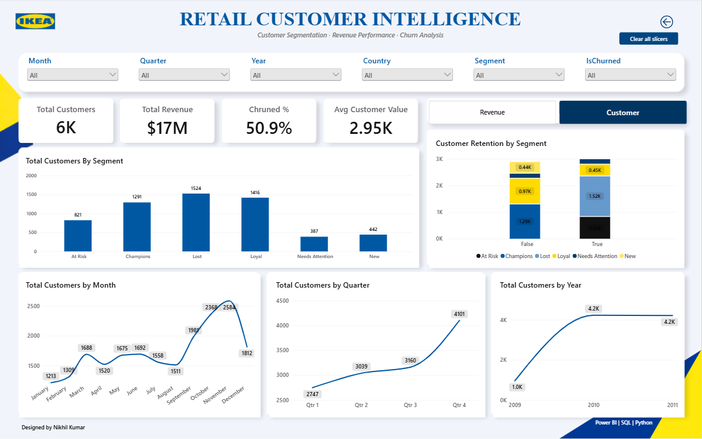
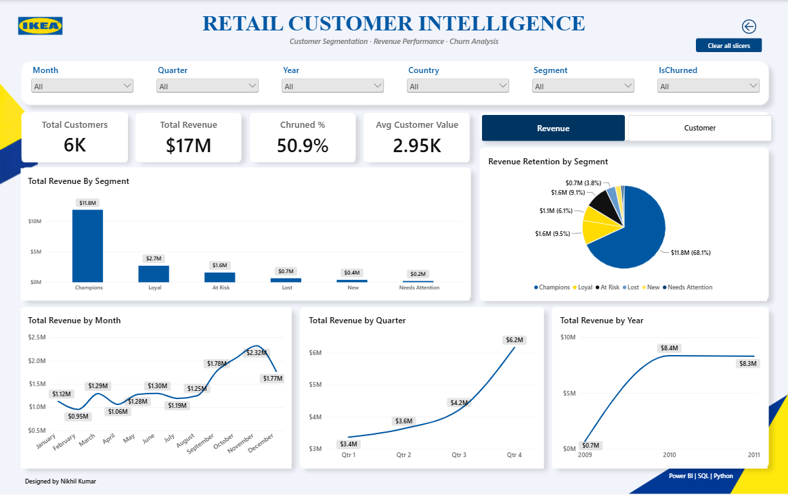
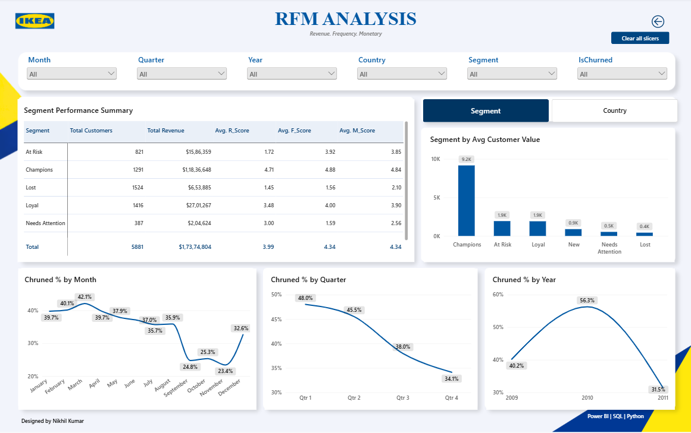
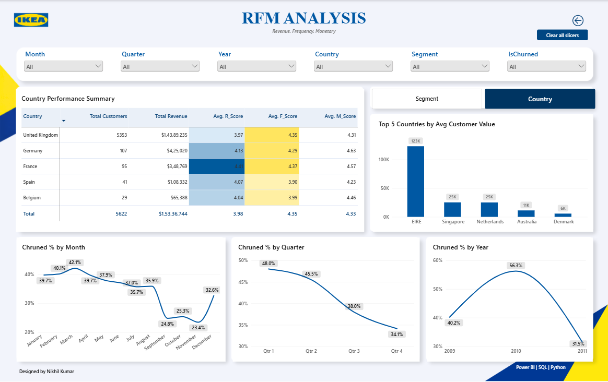

# IKEA Gifting — Customer Analytics & RFM Segmentation

**An end-to-end retail analytics case study using DuckDB SQL, Python, pandas, and Power BI.**

Transforming transaction-level retail data into customer segments, retention metrics, and business intelligence.

[](https://duckdb.org/)
[](https://pandas.pydata.org/)
[](https://jupyter.org/)
[](https://powerbi.microsoft.com/)

**Author:** Nikhil Kumar
**Project type:** Tutorial-based portfolio implementation
**Domain:** Retail Analytics | Customer Segmentation | Customer Retention

---

## Table of Contents

* [Project Overview](#project-overview)
* [Business Problem](#business-problem)
* [Business Questions](#business-questions)
* [Key Results](#key-results)
* [Dashboard Preview](#dashboard-preview)
* [Dataset](#dataset)
* [Technology Stack](#technology-stack)
* [Analytical Methodology](#analytical-methodology)
* [RFM Segmentation Framework](#rfm-segmentation-framework)
* [Repository Structure](#repository-structure)
* [Reproducing the Analysis](#reproducing-the-analysis)
* [Limitations and Assumptions](#limitations-and-assumptions)
* [Attribution and Disclaimer](#attribution-and-disclaimer)

---

## Project Overview

This project explores how transaction-level retail data can be transformed into actionable customer intelligence.

The analysis follows a business-oriented workflow: establish the business requirements, prepare and validate the transaction data in SQL, calculate customer-level RFM metrics in Python, and present the results through an interactive Power BI report.

The final dashboard allows users to examine customer value, customer segments, churn patterns, revenue trends, and geographic performance.

The project uses the **Online Retail II** dataset, which contains historical transactions from a UK-based online retailer selling giftware and related products.

### Project at a glance

| Component                                           | Implementation                             |
| --------------------------------------------------- | ------------------------------------------ |
| Business requirements                               | Business Requirements Document             |
| Data source                                         | UCI Online Retail II                       |
| Raw transaction records                             | 1,067,371                                  |
| Transaction records loaded into the Python analysis | 1,033,036                                  |
| Customers assigned RFM segments                     | 5,881                                      |
| SQL processing                                      | DuckDB                                     |
| SQL environment                                     | DBeaver                                    |
| Analytical processing                               | Python and pandas                          |
| Development environment                             | Jupyter Notebook                           |
| Business intelligence                               | Power BI Desktop                           |
| Customer segmentation                               | RFM scoring and rule-based segments        |
| Churn definition                                    | More than 90 days since the last purchase  |
| Dashboard                                           | Two report pages with bookmark-based views |

The record counts and customer totals above describe this project's current implementation, not the performance of the real IKEA corporation.

---

## Business Problem

The fictional business, IKEA Gifting, needs a clearer understanding of customer value and retention risk.

Treating every customer equally can lead to ineffective retention efforts. Some customers purchase frequently and generate substantial revenue, while others have reduced their activity or have not purchased for an extended period.

The purpose of this analysis is to help the business distinguish between customer groups and understand where retention efforts may deserve greater attention.

The business requirements and analytical scope are documented in the [Business Requirements Document](docs/IKEA_Gifting_BRD.docx).

### Business objective

Identify valuable customer segments, quantify inactivity-based churn, and provide an interactive view of customer and revenue performance to support more targeted business decisions.

## Business Questions

This project addresses the following questions:

1. Which customer segments contribute most to revenue?
2. How are customers distributed across the six RFM segments?
3. How many customers meet the defined 90-day inactivity threshold?
4. How do customer and revenue trends change over time?
5. How does customer value vary across countries?
6. Which customer groups could be prioritized for further retention analysis?

The analysis provides descriptive insights. It does not establish the causes of churn or predict which individual customers will churn in the future.

---

## Key Results

The current analysis and dashboard show the following results.

| Metric                          | Result | Interpretation                                                                            |
| ------------------------------- | -----: | ----------------------------------------------------------------------------------------- |
| Customers segmented             |  5,881 | Customers with usable identifiers and positive quantities included in the RFM calculation |
| Churn rate                      |  50.9% | Customers classified as churned under the implemented 90-day rule                         |
| Champions                       |  1,291 | Approximately 22% of the segmented customer base                                          |
| Champions' revenue contribution |  68.1% | Revenue is concentrated among the Champions segment in the current dashboard              |
| RFM segments                    |      6 | Champions, Loyal, At Risk, New, Needs Attention, and Lost                                 |

### What the results suggest

**1. Customer value is concentrated.**
The Champions segment represents approximately 22% of the segmented customer base and contributes 68.1% of the revenue displayed in the report.

**2. Inactivity deserves attention.**
The dashboard reports a churn rate of 50.9% using the project's fixed 90-day inactivity threshold. This identifies a substantial group of customers for further retention investigation.

**3. Customer behaviour differs by segment.**
The six segments provide a structured way to compare customer counts, revenue contribution, average customer value, and RFM scores.

**4. Performance varies across time and geography.**
The dashboard provides monthly, quarterly, yearly, and country-level views to support further investigation of customer and revenue patterns.

These findings are descriptive and depend on the dataset, snapshot date, filters, and segmentation rules used in this implementation.

---

## Dashboard Preview

The Power BI report contains **two pages**. Bookmark-based controls provide alternative analytical views within those pages.

### 1. Overview — Customer View

Examines customer distribution across segments, customer retention by churn status, and customer trends over time.

<p align="center">
  
</p>

### 2. Overview — Revenue View

Examines revenue contribution by customer segment, revenue retention, and revenue trends across months, quarters, and years.

<p align="center">
  
</p>

### 3. RFM Analysis — Segment View

Compares segment performance, including customer counts, revenue, average RFM scores, and average customer value.

<p align="center">
  
</p>

### 4. RFM Analysis — Country View

Provides a geographic perspective through country-level performance measures and a comparison of the top five countries by average customer value.

<p align="center">
  
</p>

### Explore the interactive report

The complete Power BI file is available at [`powerbi/IKEA.pbix`](powerbi/IKEA.pbix).

Download the file and open it in Power BI Desktop to explore its interactive visuals, slicers, and bookmark-based views.

---

## Dataset

The project uses the **Online Retail II** dataset from the [UCI Machine Learning Repository](https://archive.ics.uci.edu/dataset/502/online+retail+ii), created by Daqing Chen.

The dataset contains 1,067,371 transaction records spanning **December 1, 2009, to December 9, 2011**.

Its fields include invoice identifiers, product codes, descriptions, quantities, invoice dates, unit prices, customer identifiers, and countries.

### Data preparation

The SQL workflow combines the two annual source tables into a consolidated transaction table, standardizes data types, performs data-quality checks, and creates a deduplicated transaction table.

The Python workflow then applies the customer-analysis eligibility filters before calculating RFM metrics.

The 1,033,036 rows reported by the notebook are the records loaded from the prepared transaction dataset. The RFM calculation additionally excludes records with missing customer identifiers and non-positive quantities.

### Currency note

The source dataset records prices in British pounds sterling (£). The current Power BI report displays dollar symbols (`$`), but the SQL and Python workflows do not convert the underlying values from GBP to USD.

**The dollar symbols in the current report are formatting only, not evidence of currency conversion.** The original Power BI file is preserved unchanged in this repository version.

---

## Technology Stack

| Technology         | Role                                                                                 |
| ------------------ | ------------------------------------------------------------------------------------ |
| DuckDB SQL         | Combining source tables, type conversion, data-quality inspection, and deduplication |
| DBeaver            | SQL development and database interaction                                             |
| Python             | Customer-level analytical processing                                                 |
| pandas             | Data preparation, aggregation, scoring, segmentation, and export                     |
| Jupyter Notebook   | Interactive analytical workflow                                                      |
| Power BI Desktop   | Interactive reporting and visual exploration                                         |
| DAX                | Dashboard measures and KPI calculations                                              |
| Power BI bookmarks | Switching between customer/revenue and segment/country views                         |

### Implementation note

My initial SQL workflow used MySQL. When the server failed during the final table append, I completed the cleaning workflow using DuckDB through DBeaver. The repository therefore documents the DuckDB implementation used for the final analytical workflow.

---

## Analytical Methodology

### Step 1 — Define the business requirements

The Business Requirements Document establishes the project objective, scope, business questions, analytical definitions, stakeholders, and success criteria before the analysis begins.

### Step 2 — Consolidate and clean the transaction data

The SQL script:

* Checks row counts for the two source tables.
* Combines the annual tables with `UNION ALL`.
* Standardizes quantity, invoice date, price, and customer ID data types.
* Checks for missing dates, prices, customer IDs, and descriptions.
* Identifies non-positive quantities.
* Identifies duplicate transaction rows.
* Uses `ROW_NUMBER()` to retain one record for each repeated combination of transaction attributes.

The script creates `RetailCombined` and `RetailCleaned` in DuckDB.

The SQL quality checks identify data issues; they should not be interpreted as automatically removing every row that fails a check. Customer eligibility filtering is performed explicitly in the Python workflow.

### Step 3 — Calculate customer-level RFM metrics

Python loads the cleaned transaction data and filters out records with missing customer identifiers and non-positive quantities.

The RFM snapshot date is fixed at **December 10, 2011**.

| Metric    | Definition used in this project                                                   |
| --------- | --------------------------------------------------------------------------------- |
| Recency   | Number of days between the snapshot date and the customer's most recent purchase  |
| Frequency | Number of distinct invoices associated with the customer                          |
| Monetary  | Sum of quantity multiplied by unit price for the customer's eligible transactions |

The three metrics are scored on a scale from 1 to 5.

Recency scoring is reversed so that more recent purchasing activity receives a higher score. Frequency and Monetary scores increase with the corresponding metric.

### Step 4 — Assign customer segments

Rule-based logic maps the RFM scores to six customer segments:

* Champions
* Loyal
* At Risk
* New
* Needs Attention
* Lost

The exact rules used are documented in the [RFM Segmentation Notebook](notebooks/ikea_rfm_segmentation.ipynb).

### Step 5 — Apply the inactivity-based churn flag

A customer is flagged as churned when:

`Recency > 90 days`

This is a fixed business rule rather than the output of a predictive model.

### Step 6 — Prepare the Power BI dataset

The notebook merges customer-level RFM results back onto the eligible transaction records and exports the resulting dataset as `EcommerceDashboardData.xlsx`.

The Power BI report uses the resulting analytical data to support customer, revenue, segment, and geographic views.

---

## RFM Segmentation Framework

| Segment         | Implemented scoring rule               | Analytical interpretation                               |
| --------------- | -------------------------------------- | ------------------------------------------------------- |
| Champions       | R ≥ 4, F ≥ 4, M ≥ 4                    | Recent, frequent, and high-value purchasers             |
| Loyal           | R ≥ 3, F ≥ 3, after the Champions rule | Customers with relatively recent and frequent purchases |
| At Risk         | R ≤ 2, F ≥ 3, after preceding rules    | Previously frequent purchasers with low recency scores  |
| New             | R ≥ 4, F ≤ 2, after preceding rules    | Recent purchasers with lower purchase frequency         |
| Needs Attention | R = 3, F ≤ 2, after preceding rules    | Customers with moderate recency and lower frequency     |
| Lost            | All remaining customers                | Customers not assigned to the preceding segments        |

The order of the rules matters because the Python function assigns the first matching segment.

The RFM labels are descriptive categories based on the implemented scoring thresholds. They are not statistically trained customer classes.

---

## Repository Structure

```text
ikea-gifting-customer-analytics/
│
├── README.md
│
├── docs/
│   ├── README.md
│   └── IKEA_Gifting_BRD.docx
│
├── sql/
│   ├── README.md
│   └── 01_retail_data_cleaning_duckdb.sql
│
├── notebooks/
│   ├── README.md
│   └── ikea_rfm_segmentation.ipynb
│
└── powerbi/
    ├── README.md
    ├── IKEA.pbix
    └── screenshots/
        ├── README.md
        ├── overview_customer.png
        ├── overview_revenue.png
        ├── rfm_segment.png
        └── rfm_country.png
```

---

## Reproducing the Analysis

The repository contains the SQL script, Jupyter Notebook, and Power BI report. Reproducing the full workflow also requires the source data and the intermediate files generated during processing.

### Prerequisites

* DuckDB
* DBeaver or another compatible DuckDB SQL environment
* Python
* Jupyter Notebook
* pandas
* An Excel-writing engine supported by pandas, such as openpyxl
* Power BI Desktop

### Workflow

**1. Obtain the source dataset**

Download Online Retail II from the [UCI Machine Learning Repository](https://archive.ics.uci.edu/dataset/502/online+retail+ii).

**2. Import the source tables**

Import the respective annual data into DuckDB using the table names expected by the SQL script:

* `main.year_2009_2010`
* `main.year_2010_2011`

Confirm that the imported columns correspond to those referenced in the SQL script.

**3. Execute the SQL workflow**

Run [`01_retail_data_cleaning_duckdb.sql`](sql/01_retail_data_cleaning_duckdb.sql) in DuckDB.

The source tables must exist before the script is executed.

**4. Export the cleaned table**

Export `main.RetailCleaned` to a CSV file named `RetailCleaned.csv`.

Place it in the notebook's working directory, or update the input path in the notebook.

**5. Run the Python Notebook**

Open [`ikea_rfm_segmentation.ipynb`](notebooks/ikea_rfm_segmentation.ipynb) and execute the cells sequentially.

The notebook calculates RFM metrics, assigns customer segments, applies the churn flag, and exports `EcommerceDashboardData.xlsx`.

**6. Refresh the Power BI report**

Open [`IKEA.pbix`](powerbi/IKEA.pbix) in Power BI Desktop.

If the report's source path differs from your local environment, update the data source to the generated Excel file and refresh the report.

### Important reproducibility considerations

* The SQL script expects the source tables to have already been imported.
* The SQL script creates named tables, so an existing database may require table cleanup before rerunning it.
* The Notebook uses a fixed RFM snapshot date of December 10, 2011.
* The intermediate CSV and Excel files must be generated locally as part of the workflow.

---

## Limitations and Assumptions

**Historical analysis:** The dataset contains historical transactions and does not represent current customer activity.

**Fixed churn threshold:** Churn is defined as more than 90 days without a purchase. This threshold is a business assumption, not a statistically optimized cutoff.

**No predictive churn model:** The churn flag is rule-based. The project does not estimate future churn probabilities.

**Customer eligibility:** Records without customer identifiers and records with non-positive quantities are excluded from the customer-level RFM workflow.

**Retail and wholesale customers:** The analysis does not explicitly separate wholesale buyers from individual retail customers.

**No causal analysis:** The observed trends do not establish that seasonality, promotions, or other external factors caused changes in customer or revenue behaviour.

**Currency formatting:** The current Power BI report displays dollar symbols without converting the original price values from GBP. The dashboard is preserved unchanged in this version.

**Static screenshots:** The PNG previews are snapshots. Interactive functionality is available through the `.pbix` file in Power BI Desktop.

---

## Attribution and Disclaimer

### Tutorial attribution

This is a tutorial-based portfolio implementation. The original workflow and dashboard approach were followed from the work of Mansi Goel.

* [Original GitHub repository](https://github.com/the-mansi-goel/IKEA)
* [YouTube walkthrough](https://www.youtube.com/watch?v=LQa0SiuZfhA)

The main implementation difference documented here is the use of DuckDB through DBeaver for the SQL cleaning workflow after a MySQL server failure during the final table append.

The tutorial and its original creator are acknowledged here to distinguish the source methodology from this repository's implementation.

### Dataset attribution

Chen, D. (2012). *Online Retail II*. UCI Machine Learning Repository. https://doi.org/10.24432/C5CG6D.

The dataset is licensed under Creative Commons Attribution 4.0 International (CC BY 4.0). Refer to the [official dataset page](https://archive.ics.uci.edu/dataset/502/online+retail+ii) for source details and license terms.

### Business disclaimer

**IKEA Gifting is a fictional business name used for this educational portfolio project.** This project is not affiliated with, endorsed by, or representative of the real IKEA corporation.

All customer counts, revenue figures, segments, and other metrics refer to the public historical dataset and the analytical methods used in this project. They do not reflect IKEA's actual business performance.
