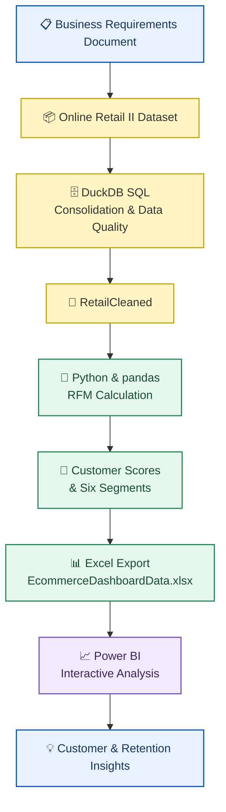

<div align="center">

# 🛍️ IKEA Gifting

## Customer Analytics & RFM Segmentation


<p>
  <strong>Turning retail transactions into customer intelligence and actionable business insights.</strong>
</p>

<br>

<a href="https://www.python.org/">
  
</a>
<a href="https://duckdb.org/">
  
</a>
<a href="https://jupyter.org/">
  
</a>
<a href="https://powerbi.microsoft.com/">
  
</a>

<br><br>

<a href="powerbi/IKEA.pbix">
  
</a>
<a href="docs/IKEA_Gifting_BRD.docx">
  
</a>

<br>

**Author:** Nikhil Kumar
**Domain:** Customer Analytics · Retail Intelligence · Customer Retention

</div>

---

## 📌 Project at a Glance

A business-oriented analytics project built around a fictional UK-based gifting retailer. The objective is to understand customer value, identify customers meeting a defined inactivity threshold, and explore customer behaviour across segments, time periods, and geographic markets.

The workflow connects business requirements to SQL data preparation, Python-based RFM segmentation, and an interactive Power BI report.

<table>
<tr>
<td align="center" width="25%">

<h2>5,881</h2>
<strong>CUSTOMERS SEGMENTED</strong>

Customers represented in the RFM segment summary.

</td>
<td align="center" width="25%">

<h2>50.9%</h2>
<strong>CHURN FLAG RATE</strong>

Based on the implemented 90-day inactivity rule.

</td>
<td align="center" width="25%">

<h2>68.1%</h2>
<strong>CHAMPIONS' REVENUE SHARE</strong>

Revenue contribution shown in the dashboard.

</td>
<td align="center" width="25%">

<h2>6</h2>
<strong>RFM SEGMENTS</strong>

Six rule-based customer groups.

</td>
</tr>
</table>

<sub>Metrics reflect this project's current analysis and report. They are not actual IKEA corporate performance figures.</sub>

---

## 🎯 Business Problem

Customer bases are rarely uniform. A relatively small group of customers may contribute a substantial share of revenue, while other customers purchase infrequently or become inactive.

Without structured customer analysis, marketing and retention teams may struggle to distinguish high-value relationships from customers who require re-engagement.

This project explores how transaction data can support more targeted customer decisions through segmentation, revenue analysis, and inactivity-based churn identification.

### Business objectives

* Identify customers and segments that contribute most to revenue.
* Quantify customers meeting the project's churn definition.
* Compare customer value and retention patterns over time.
* Explore differences across geographic markets.
* Translate analytical segments into potential retention priorities.

📄 **Business requirements:** [View the Business Requirements Document](docs/IKEA_Gifting_BRD.docx)

---

## 📊 Dashboard Showcase

The Power BI report contains **two pages with four bookmark-based analytical views**.

Click any screenshot to open the full-size image.

<table>
<tr>
<td align="center" width="50%">

### 01 · Overview — Customer

<a href="powerbi/screenshots/overview_customer.png">

</a>

Customer distribution, retention by segment, and customer trends across months, quarters, and years.

</td>
<td align="center" width="50%">

### 02 · Overview — Revenue

<a href="powerbi/screenshots/overview_revenue.png">

</a>

Revenue contribution by segment, revenue retention, and revenue trends over time.

</td>
</tr>
<tr>
<td align="center" width="50%">

### 03 · RFM Analysis — Segment

<a href="powerbi/screenshots/rfm_segment.png">

</a>

Segment performance, customer counts, revenue contribution, average RFM scores, and average customer value.

</td>
<td align="center" width="50%">

### 04 · RFM Analysis — Country

<a href="powerbi/screenshots/rfm_country.png">

</a>

Country performance, geographic comparisons, and the top five countries by average customer value.

</td>
</tr>
</table>

<div align="center">

### 🚀 Explore the interactive report

[**Download IKEA.pbix**](powerbi/IKEA.pbix) · [Dashboard documentation](powerbi/README.md)

</div>

<sub>The PNG images are static previews. Open the Power BI file in Power BI Desktop to explore the report's interactive slicers, buttons, and bookmark-based views.</sub>

---

## 💡 Key Findings

### 01. Revenue is concentrated among Champions

The Champions segment contains **1,291 customers**, approximately 22% of the 5,881 customers in the segment summary. The dashboard attributes 68.1% of its displayed revenue to this group.

This concentration makes Champions an important group to understand when evaluating customer value and possible retention priorities.

### 02. Inactivity is a significant analytical signal

The dashboard reports a **50.9% churn flag rate** using the project's fixed 90-day inactivity threshold.

This indicates that a substantial portion of the analyzed customer base meets the report's inactivity criterion. It does not establish whether these customers will permanently leave the business.

### 03. Customer segments have different value profiles

The analysis distinguishes six groups using Recency, Frequency, and Monetary scores. The dashboard makes it possible to compare their customer counts, revenue contribution, average RFM scores, and average customer value.

### 04. Time and geography provide additional perspectives

The Overview page contains monthly, quarterly, and yearly customer and revenue trends. The RFM Analysis page adds country-level comparisons and churn trends over time.

The report supports further investigation of these patterns; it does not establish their causes.

---

## 🧰 Technology Stack

<table>
<tr>
<th align="left">Technology</th>
<th align="left">Purpose</th>
</tr>
<tr>
<td><strong>DuckDB SQL</strong></td>
<td>Transaction consolidation, type standardization, data-quality inspection, and deduplication.</td>
</tr>
<tr>
<td><strong>DBeaver</strong></td>
<td>SQL development and database interaction.</td>
</tr>
<tr>
<td><strong>Python</strong></td>
<td>Customer-level analytical processing.</td>
</tr>
<tr>
<td><strong>pandas</strong></td>
<td>Data preparation, aggregation, RFM scoring, segmentation, and export.</td>
</tr>
<tr>
<td><strong>Jupyter Notebook</strong></td>
<td>Interactive analysis and documented analytical workflow.</td>
</tr>
<tr>
<td><strong>Power BI Desktop</strong></td>
<td>Interactive dashboards, KPI presentation, filtering, and bookmark-based views.</td>
</tr>
<tr>
<td><strong>DAX</strong></td>
<td>Business measures and dashboard KPIs.</td>
</tr>
</table>

---

## ⚙️ End-to-End Workflow



### Step 1 — Define the business requirements

The BRD establishes the problem, objectives, scope, key definitions, stakeholder needs, and success criteria.

### Step 2 — Prepare the transaction data

The DuckDB SQL workflow combines the two annual source tables, standardizes key data types, measures data-quality issues, identifies exact duplicate groups, and builds a deduplicated transaction table.

The script creates:

* `RetailCombined`
* `RetailCleaned`
* `RetailDataQualitySummary`

The cleaned SQL table intentionally retains missing customer identifiers and non-positive quantities. These records remain available for data-quality inspection.

### Step 3 — Calculate customer-level RFM metrics

The notebook loads `RetailCleaned.csv`, excludes rows with missing customer IDs and non-positive quantities from the customer analysis, and calculates RFM metrics using a fixed snapshot date of **December 10, 2011**.

### Step 4 — Score and segment customers

Each customer receives a Recency, Frequency, and Monetary score from 1 to 5. The scoring uses quantile-based bins, with Recency scored in reverse order so that more recent purchasing activity receives a higher score.

Rule-based logic assigns customers to six segments.

### Step 5 — Apply the churn flag

The notebook flags a customer as churned when:

```python
rfm["IsChurned"] = rfm["Recency"] > 90
```

This is an inactivity-based business rule, not a predictive churn model.

### Step 6 — Export and visualize

The notebook merges customer-level RFM results onto the eligible transaction data and exports `EcommerceDashboardData.xlsx`.

Power BI uses the prepared output for customer, revenue, segment, and geographic analysis.

---

## 🧠 RFM Segmentation Framework

RFM represents three dimensions of customer purchasing behaviour.

| Metric            | Meaning                                  | Higher score indicates          |
| ----------------- | ---------------------------------------- | ------------------------------- |
| **Recency (R)**   | Days since the most recent purchase      | More recent purchasing activity |
| **Frequency (F)** | Number of distinct invoices              | More frequent transactions      |
| **Monetary (M)**  | Sum of quantity multiplied by unit price | Higher transaction value        |

### Segment definitions

<details>
<summary><strong>🏆 Champions</strong></summary>

Customers with `R_Score >= 4`, `F_Score >= 4`, and `M_Score >= 4`.

These customers score highly across recency, frequency, and monetary value.

</details>

<details>
<summary><strong>💙 Loyal</strong></summary>

Customers assigned after the Champions rule who satisfy `R_Score >= 3` and `F_Score >= 3`.

They demonstrate relatively recent and frequent purchasing activity.

</details>

<details>
<summary><strong>⚠️ At Risk</strong></summary>

Customers assigned after the preceding rules who satisfy `R_Score <= 2` and `F_Score >= 3`.

They have lower Recency scores despite a comparatively high Frequency score.

</details>

<details>
<summary><strong>🌱 New</strong></summary>

Customers assigned after the preceding rules who satisfy `R_Score >= 4` and `F_Score <= 2`.

They have recent purchasing activity but relatively low purchase frequency.

</details>

<details>
<summary><strong>🔎 Needs Attention</strong></summary>

Customers assigned after the preceding rules who satisfy `R_Score == 3` and `F_Score <= 2`.

They have moderate Recency scores and comparatively low Frequency scores.

</details>

<details>
<summary><strong>🕰️ Lost</strong></summary>

Customers who do not match any of the preceding segment rules.

This is the remaining rule-based category, not an independently trained customer class.

</details>

The order of the rules matters because the notebook assigns the first matching segment.

---

## 🗂️ Repository Structure

```text
ikea-gifting-customer-analytics/
│
├── README.md
│
├── docs/
│   ├── README.md
│   └── IKEA_Gifting_BRD.docx
│
├── sql/
│   ├── README.md
│   └── 01_retail_data_cleaning_duckdb.sql
│
├── notebooks/
│   ├── README.md
│   └── ikea_rfm_segmentation.ipynb
│
└── powerbi/
    ├── README.md
    ├── IKEA.pbix
    └── screenshots/
        ├── README.md
        ├── overview_customer.png
        ├── overview_revenue.png
        ├── rfm_segment.png
        └── rfm_country.png
```

---

## ▶️ Reproduce the Analysis

### Prerequisites

* DuckDB
* DBeaver or another compatible SQL client
* Python
* pandas
* An Excel-writing engine supported by pandas, such as `openpyxl`
* Power BI Desktop

### 1. Obtain the dataset

Download **Online Retail II** from the [UCI Machine Learning Repository](https://archive.ics.uci.edu/dataset/502/online+retail+ii).

The source data contains 1,067,371 transaction rows covering December 2009 to December 2011.

The raw dataset is not currently stored in this repository.

### 2. Import the annual source tables

Import the two annual sheets into DuckDB using the table names expected by the SQL script:

```text
main.year_2009_2010
main.year_2010_2011
```

Confirm that the imported columns match the column names referenced in the SQL script.

### 3. Run the SQL workflow

Open and execute:

[`sql/01_retail_data_cleaning_duckdb.sql`](sql/01_retail_data_cleaning_duckdb.sql)

The source tables must exist before execution.

Review the data-quality summary and post-cleaning validation results.

### 4. Export the cleaned data

Export `main.RetailCleaned` to a CSV file named:

```text
RetailCleaned.csv
```

Place it in the Jupyter Notebook's working directory, or update the notebook's file path.

### 5. Run the Python notebook

Open:

[`notebooks/ikea_rfm_segmentation.ipynb`](notebooks/ikea_rfm_segmentation.ipynb)

Execute the cells sequentially.

The notebook calculates RFM metrics, assigns segments, creates the churn flag, and exports:

```text
EcommerceDashboardData.xlsx
```

### 6. Open the Power BI report

Open [`powerbi/IKEA.pbix`](powerbi/IKEA.pbix) in Power BI Desktop.

If the report points to a different local file path, update the source configuration to the generated Excel file and refresh the report.

---

## ⚠️ Limitations & Assumptions

* **Historical dataset:** The analysis uses transactions from 2009–2011 and does not represent current customer behaviour.
* **Fixed snapshot date:** RFM metrics are calculated relative to December 10, 2011.
* **Rule-based churn:** The churn flag uses a fixed threshold of more than 90 days since the last purchase. It does not predict future churn.
* **Customer eligibility:** Records with missing customer IDs and non-positive quantities are excluded from the customer-level RFM analysis.
* **Wholesale versus retail:** The analysis does not explicitly separate wholesale customers from individual retail buyers.
* **No causal conclusions:** Historical trends do not establish why customer activity or revenue changed.
* **Currency formatting:** The source prices are denominated in British pounds sterling (£), but the current Power BI report displays `$` symbols without converting the underlying values to USD. The dashboard is preserved unchanged; dollar symbols should be interpreted as formatting, not currency conversion.
* **Static previews:** The PNG screenshots show report states but do not provide interactive filtering or bookmark functionality.

---

## 📚 Data Source & Disclaimer

**Dataset:** Chen, D. (2012). *Online Retail II*. UCI Machine Learning Repository.

* [Official dataset page](https://archive.ics.uci.edu/dataset/502/online+retail+ii)
* [Dataset DOI](https://doi.org/10.24432/C5CG6D)
* **Dataset license:** Creative Commons Attribution 4.0 International (CC BY 4.0)

The dataset describes historical transactions from a UK-based, non-store online retailer selling all-occasion giftware.

**Business disclaimer:** IKEA Gifting is a fictional company name used for this educational analytics project. This project is not affiliated with, endorsed by, or representative of the real IKEA corporation. All customer counts, financial figures, and analytical results refer to the public historical dataset and this project's implementation.

---

<div align="center">

### Built with SQL · Python · Power BI

**From transaction data to customer intelligence.**

</div>
